

<picture>
  <source media="(prefers-color-scheme: dark)" srcset="assets/icon/Logo_Horizontal_OnDark.png">
  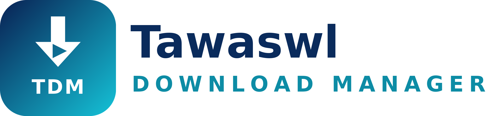
</picture>

<h1>Tawaswl Internet Service "TDM"</h1>

<b>TDM</b>

ملفك يصل كاملًا، مهما بعدت المسافة.

Your file arrives whole, however far it comes from.

<a href="https://github.com/tawaswlsy-stack/TDM/releases/latest">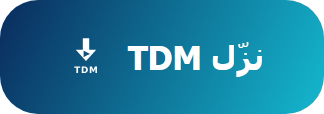</a>&nbsp;
<a href="https://tdm.by-wow.com">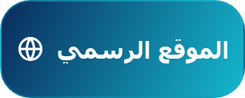</a>&nbsp;
<a href="#support-ar">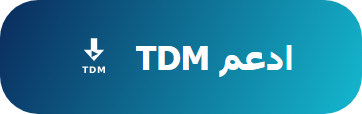</a>

<a href="#english">English below</a>

<picture>
  <source media="(prefers-color-scheme: dark)" srcset="docs/media/site-hero-dark.webp">
  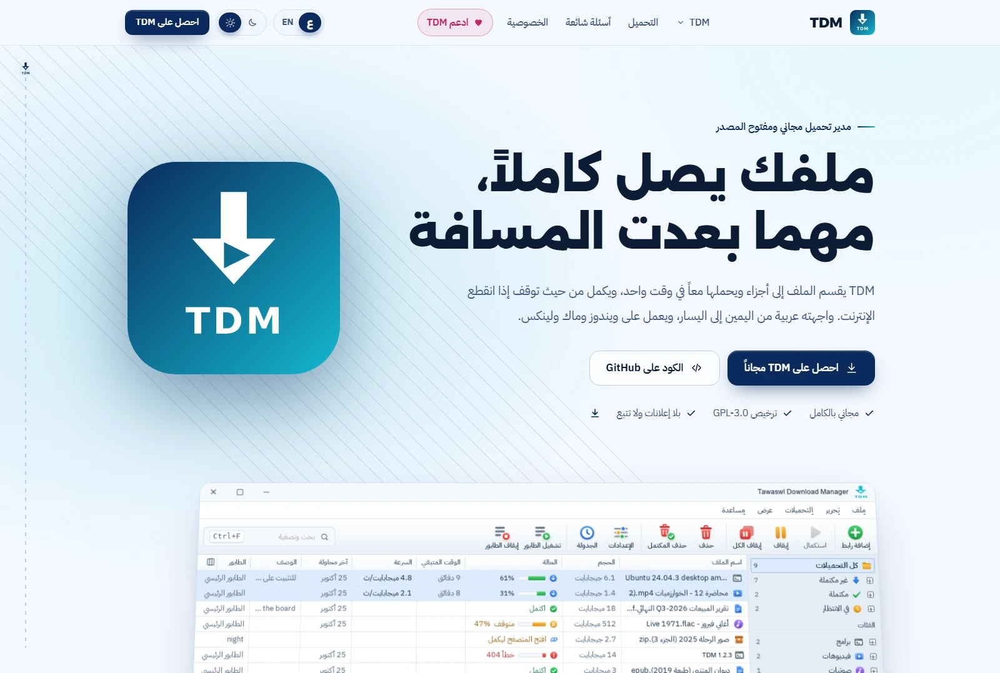
</picture>

## Tawaswl Internet Service "TDM"

**TDM** برنامج مجاني ومفتوح المصدر لإدارة التحميل، على **ويندوز وماك ولينكس**. واجهته **عربية أولًا** (من اليمين إلى اليسار)، والإنجليزية بضغطة زر.

اخترنا اسم **Tawaswl** لأن البرنامج يبقي تنزيلاتك متصلة ويستأنفها عند انقطاع الشبكة؛ ليصل ملفك كاملًا وسليمًا مهما كان مصدره.

**[TDM 1.2.3](https://github.com/tawaswlsy-stack/TDM/releases/tag/v1.2.3) منشور،** وهو أخف: يترك نافذته وهو في شريط النظام (نحو 65 ميجابايت بدل 400 على ماك)، ويستهلك ذاكرة أقل والنافذة مفتوحة. وفي 1.2: التحديث التلقائي الموقّع بمفتاح المشروع (بموافقتك دائمًا)، واستكمال كل فيديو مهما كانت طريقة تنزيله، و«جودة الفيديو» لرابط يوتيوب تضيفه بيدك. وفي 1.1: جودات يوتيوب فورًا في زر الإضافة، يحمّلها محرّك TDM نفسه ويستكملها، والفيديو وقوائم التشغيل في الطوابير، وBrave وOpera وVivaldi، وشكل جديد بأيقونات ملونة. وما بعده في [ROADMAP](docs/ROADMAP.md).

## ما يفعله TDM

- **أسرع**: يقسم الملف إلى أجزاء ويحمّلها معًا، حتى 32 اتصالًا، وحين يفرغ اتصال يأخذ نصف ما بقي من أبطأ جزء.
- **لا يضيع شيء**: يكمل التحميل بعد انقطاع الإنترنت أو إغلاق البرنامج، ويتأكد أن الملف على السيرفر لم يتغير.
- **الفيديو**: في يوتيوب يعرض زر الإضافة الجودات فورًا بحجمها، ويحمّل TDM الصورة والصوت بعدة اتصالات ويستكملهما. ونافذة «جودة الفيديو» تعرض الجودات بحجمها، و«صوت فقط»، وقوائم التشغيل كاملة. يتحقق ffprobe من التدفقات والجودة قبل إعلان الاكتمال، ويعرض سجل النشاط الحي أحداث المحركات والتحقق. ولا يتجاوز أي حماية DRM.
- **من المتصفح**: إضافة لـ Chrome وEdge وFirefox ترسل التحميلات إلى TDM، وزر «نزّل الفيديو» فوق الفيديو.
- **تنظيم**: طوابير، وجدولة بالساعة واليوم، وحد للسرعة، وفئات تلقائية، و«تحميل الموقع»، و«تحميل بالجملة».
- **عربي حقيقي**: الواجهة مصممة من اليمين إلى اليسار من البداية، بالوضع الفاتح والداكن.
- **خصوصية كاملة**: لا حساب، ولا تتبع، ولا إحصاءات، ولا إعلانات، ولا برامج مرفقة.

## صور

صور حقيقية من البرنامج (بيانات تجريبية فقط):

<table>
<tr>
<td width="50%">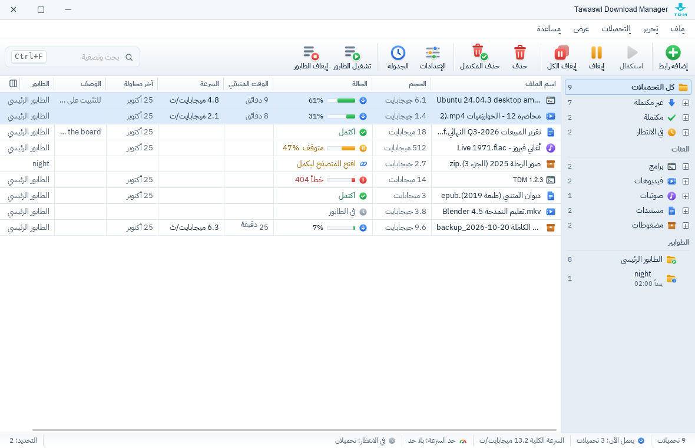 النافذة الرئيسية، فاتح</td>
<td width="50%">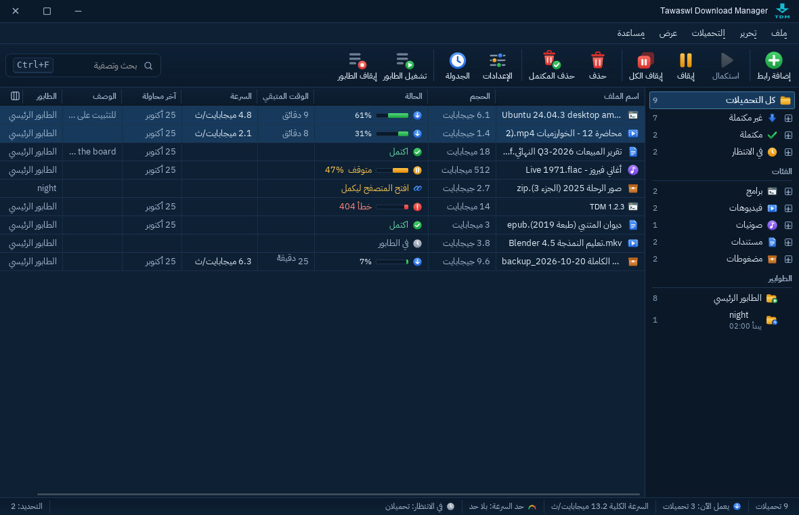 النافذة الرئيسية، داكن</td>
</tr>
<tr>
<td>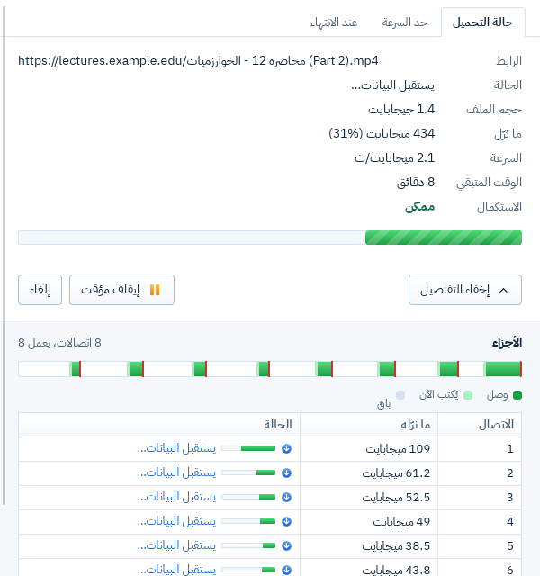 نافذة التقدم: الأجزاء والاتصالات</td>
<td>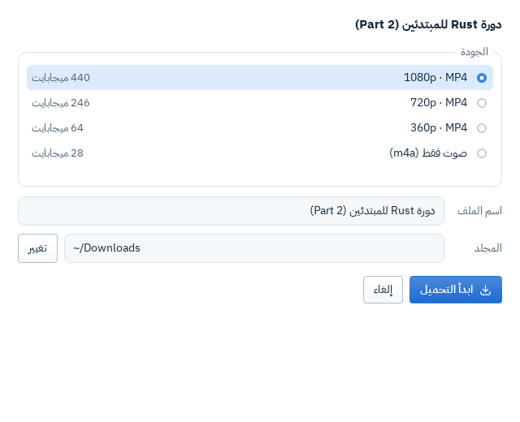 «جودة الفيديو»</td>
</tr>
<tr>
<td>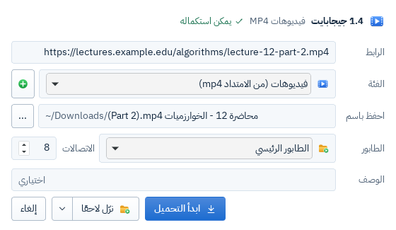 «معلومات ملف التحميل»</td>
<td>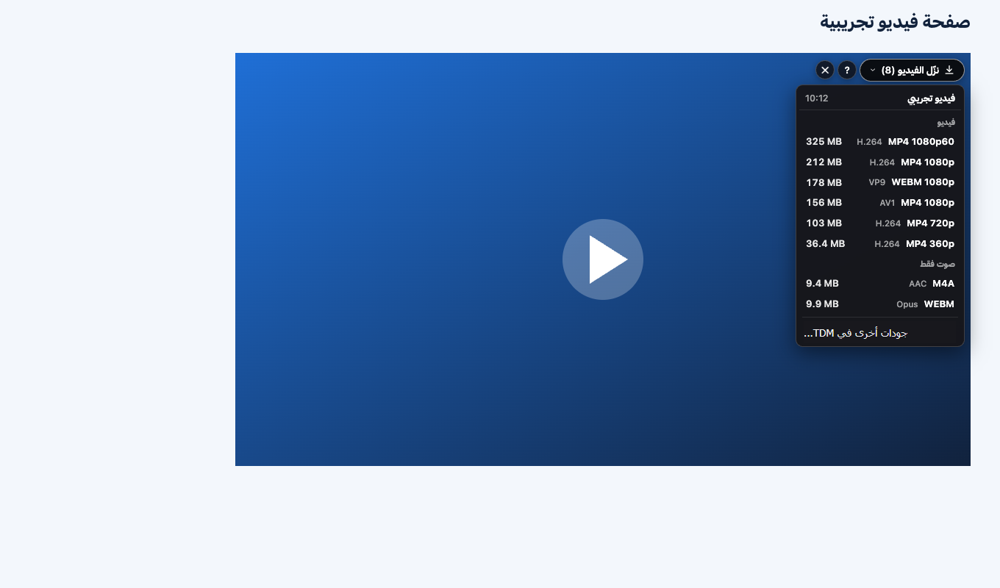 زر «نزّل الفيديو» من الإضافة</td>
</tr>
<tr>
<td>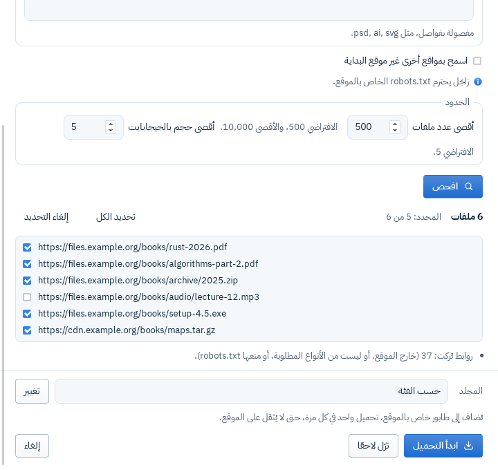 «تحميل الموقع»</td>
<td>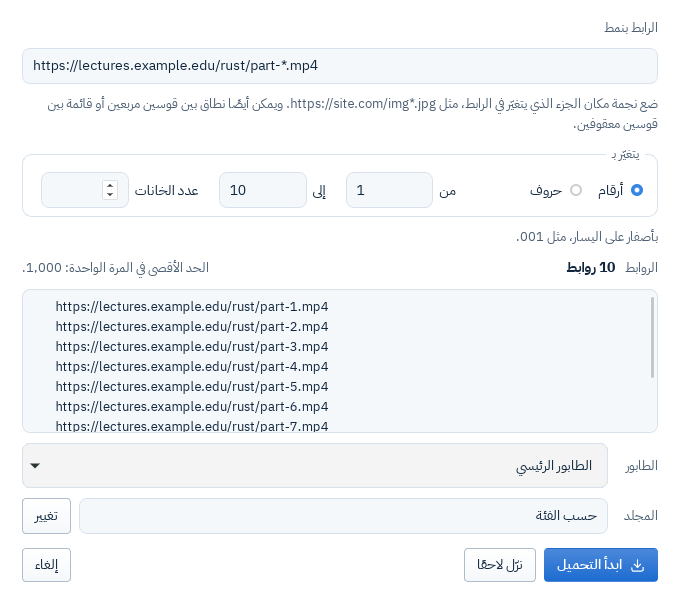 «تحميل بالجملة»</td>
</tr>
</table>

## التحميل والتثبيت

نزّل الملف المناسب من [صفحة آخر إصدار](https://github.com/tawaswlsy-stack/TDM/releases/latest): ويندوز 10 و11، وmacOS 11 أو أحدث، ولينكس (`.deb` وAppImage)، وإضافة Chrome وEdge وFirefox، ومعها `SHA256SUMS`.

TDM **غير موقّع من Apple ولا Microsoft**، فيظهر تحذير أول مرة. خطوات فتحه على كل نظام، وتركيب الإضافة، والتأكد من الملفات، في [صفحة التحميل على الموقع](https://tdm.by-wow.com/download/#install).

مصادره الرسمية الوحيدة: هذا المستودع، والموقع [tdm.by-wow.com](https://tdm.by-wow.com).

## التواصل والمساعدة

- ⭐ **نجمة على المستودع**: تساعد غيرك على أن يجد TDM.
- 🐞 **أبلغ عن مشكلة** أو اقترح فكرة في [Issues](https://github.com/tawaswlsy-stack/TDM/issues)، بالعربية أو بالإنجليزية.
- ✉️ **تواصل معنا** عبر [tawaswl.sy@gmail.com](mailto:tawaswl.sy@gmail.com).
- 🌐 **ساعد في الترجمة**: نصوص الواجهة في [ملفات الترجمة](locales).
- 📣 **أخبر غيرك عن TDM**، وشارك رابط [الموقع](https://tdm.by-wow.com).

## ما لن يفعله TDM

- لن يتجاوز أي حماية للمحتوى (DRM).
- لن يجمع أي بيانات عنك.
- لن يعتمد على تعريف داخل النظام (kernel driver).

التفاصيل في [وثيقة المتطلبات](docs/PRD.md).

## الوثائق

| الوثيقة | المحتوى |
|---|---|
| [docs/PRD.md](docs/PRD.md) | المتطلبات، ومن المستخدم، وما يفعله البرنامج وما لا يفعله |
| [docs/ARCHITECTURE.md](docs/ARCHITECTURE.md) | بنية البرنامج: المحرّك، وسطر الأوامر، والواجهة، والإضافة |
| [docs/ROADMAP.md](docs/ROADMAP.md) | المراحل وشروط نجاح كل مرحلة |
| [docs/PARITY.md](docs/PARITY.md) | مقارنة ميزات IDM العامة بما يقدمه TDM |
| [docs/adr/](docs/adr/) | سجل القرارات المعمارية |
| [docs/DEPENDENCIES.md](docs/DEPENDENCIES.md) | سجل تراخيص المكتبات |
| [CONTRIBUTING.md](CONTRIBUTING.md) | كيف تساهم، وقاعدة الغرفة النظيفة |
| [AGENTS.md](AGENTS.md) | قواعد العمل لأي جلسة تبني المشروع |
| [SECURITY.md](SECURITY.md) | كيف تبلّغ عن ثغرة أمنية |

## الرخصة

TDM برنامج حر بترخيص [GPL-3.0-or-later](LICENSE).

لتحميل الفيديو، ينزّل TDM بموافقتك ffmpeg وffprobe من بنائه الخاص لمشروع FFmpeg. FFmpeg ملك أصحابه ([ffmpeg.org](https://ffmpeg.org))، وترخيصه LGPL 2.1 أو أحدث، ومصدر النسخة التي ينزّلها TDM وطريقة بنائها في [إصدار tools-ffmpeg-8.1.3-1](https://github.com/tawaswlsy-stack/TDM/releases/tag/tools-ffmpeg-8.1.3-1).

This software uses code of [FFmpeg](https://ffmpeg.org) licensed under the [LGPLv2.1](https://www.gnu.org/licenses/old-licenses/lgpl-2.1.html) and its source can be downloaded [here](https://github.com/tawaswlsy-stack/TDM/releases/tag/tools-ffmpeg-8.1.3-1).

## تنبيه

TDM مشروع مستقل، ولا علاقة له بشركة Tonec ولا ببرنامج Internet Download Manager (IDM). كُتب من الصفر، اعتمادًا على المعايير المنشورة ووثائق المتصفحات الرسمية فقط. التفاصيل في [قاعدة الغرفة النظيفة](CONTRIBUTING.md#قاعدة-الغرفة-النظيفة).

---

<a href="https://github.com/tawaswlsy-stack/TDM/releases/latest">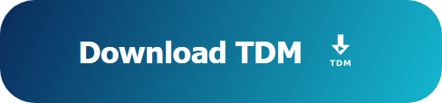</a>&nbsp;
&nbsp;
<a href="#support-en">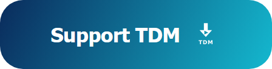</a>

## TDM

**TDM** is a free and open-source download manager for **Windows, macOS and Linux**. Its interface is **Arabic first** (right to left), with English in one click.

We chose **Tawaswl** to reflect how the app keeps downloads connected and resumes them after a network drop, so your file arrives whole and sound.

**[TDM 1.2.3](https://github.com/tawaswlsy-stack/TDM/releases/tag/v1.2.3) is out,** and lighter: it lets its window go while in the tray (about 65 MB instead of 400 on macOS), and takes less memory with the window open. From 1.2: signed automatic updates (always with your OK), every video resuming whichever way it downloads, and «Video quality» for a YouTube link you add by hand. From 1.1: YouTube's qualities at once in the extension's button, downloaded and resumed by TDM's own engine; videos and playlists in queues; Brave, Opera and Vivaldi; and a new look with coloured icons. What comes next is in the [ROADMAP](docs/ROADMAP.md).

## What TDM does

- **Faster**: it splits a file into parts and downloads them together, up to 32 connections, and when a connection is free it takes half of what is left of the slowest part.
- **Nothing is lost**: downloads go on after the connection drops or the program closes, and TDM makes sure the file on the server has not changed.
- **Videos**: on YouTube the extension's button lists the qualities at once with their sizes, and TDM downloads the picture and the sound over several connections, resumable. The “Video quality” window shows each quality with its size, “Sound only”, and whole playlists. FFprobe verifies streams and quality before completion, and the Live Activity Log shows engine and verification events. TDM never gets around DRM.
- **From the browser**: an extension for Chrome, Edge and Firefox hands downloads to TDM, with a floating “Download video” button that appears when a video starts playing. When several videos are playing, its menu lists them so you can choose which one to send. A toolbar button pastes a copied link into TDM.
- **Organised**: queues, scheduling by hour and day, speed limits, automatic categories, “Site grabber” and “Batch download”.
- **Truly Arabic**: the interface was built right to left from the start, with system/light/dark modes and selectable TDM, ocean, forest and sunset color templates. Windows installers use branded TDM artwork.
- **Fully private**: no account, no tracking, no analytics, no ads, nothing bundled.

## Screenshots

Real screenshots of the program, in Arabic (test data only):

<table>
<tr>
<td width="50%"> The main window, light</td>
<td width="50%"> The main window, dark</td>
</tr>
<tr>
<td> The progress window: parts and connections</td>
<td> “Video quality”</td>
</tr>
<tr>
<td> “Download file info”</td>
<td> The extension's “Download video” button</td>
</tr>
<tr>
<td> “Site grabber”</td>
<td> “Batch download”</td>
</tr>
</table>

## Download and install

Get your file from the [latest release](https://github.com/tawaswlsy-stack/TDM/releases/latest): Windows 10 and 11, macOS 11 or later, Linux (`.deb` and AppImage), and the Chrome, Edge and Firefox extension, with `SHA256SUMS`.

TDM is **not signed by Apple or Microsoft**, so a warning shows the first time. How to open it on each system, add the extension and check the files is on [the site's download page](https://tdm.by-wow.com/en/download/#install).

Its only official sources are this repository and the site, [tdm.by-wow.com](https://tdm.by-wow.com/en/).

## Contact and contribute

- ⭐ **Star the repository**: it helps others find TDM.
- 🐞 **Report a problem** or suggest an idea in [Issues](https://github.com/tawaswlsy-stack/TDM/issues), in Arabic or English.
- ✉️ **Contact us** at [tawaswl.sy@gmail.com](mailto:tawaswl.sy@gmail.com).
- 🌐 **Help with translation**: the interface's text is in the [translation files](locales).
- 📣 **Tell others about TDM**, and share the [site](https://tdm.by-wow.com/en/).

## What TDM will not do

- Get around any content protection (DRM).
- Collect any data about you.
- Rely on a driver inside the system (kernel driver).

The details are in the [requirements](docs/PRD.md).

## Documents

| Document | What it covers |
|---|---|
| [docs/PRD.md](docs/PRD.md) | Requirements, who the users are, and what the program does and does not do |
| [docs/ARCHITECTURE.md](docs/ARCHITECTURE.md) | How it is built: the engine, the command line, the interface and the extension |
| [docs/ROADMAP.md](docs/ROADMAP.md) | The milestones and what each must pass |
| [docs/PARITY.md](docs/PARITY.md) | IDM's public features compared with TDM's |
| [docs/adr/](docs/adr/) | Architecture decision records |
| [docs/DEPENDENCIES.md](docs/DEPENDENCIES.md) | Licences of the libraries |
| [CONTRIBUTING.md](CONTRIBUTING.md) | How to contribute, and the clean-room rule |
| [AGENTS.md](AGENTS.md) | Working rules for every session that builds the project |
| [SECURITY.md](SECURITY.md) | How to report a security issue |

## Licence

TDM is free software under [GPL-3.0-or-later](LICENSE). For video, TDM downloads, once you agree, ffmpeg and ffprobe from its own build of FFmpeg (LGPL 2.1 or later; [source and build](https://github.com/tawaswlsy-stack/TDM/releases/tag/tools-ffmpeg-8.1.3-1)).

## Notice

TDM is an independent clean-room project. It is not affiliated with Tonec or Internet Download Manager (IDM). It was written from scratch, from published standards and the browsers' official documentation only. See the [clean-room rule](CONTRIBUTING.md).
