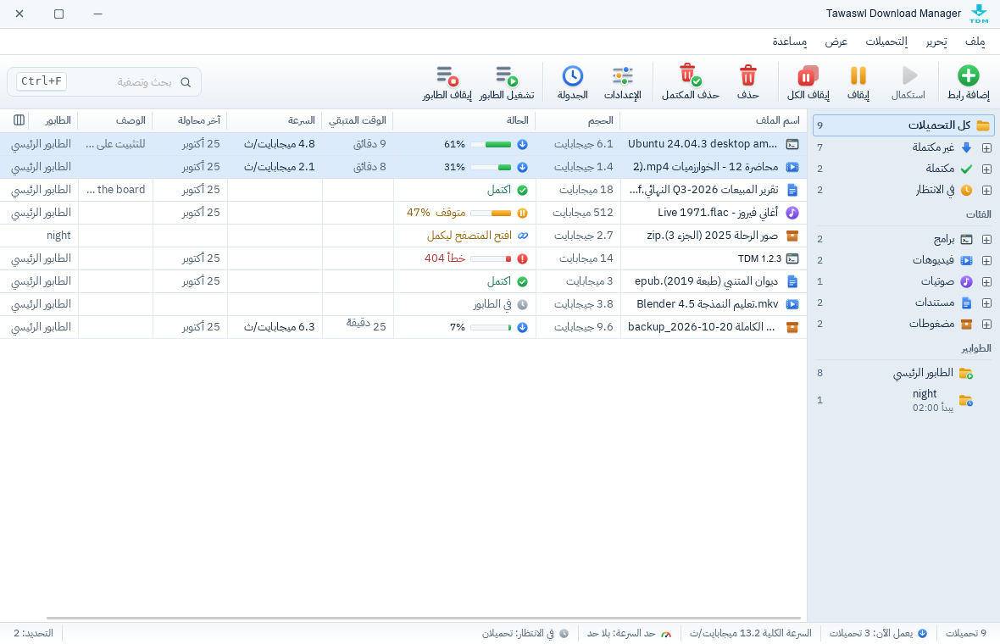
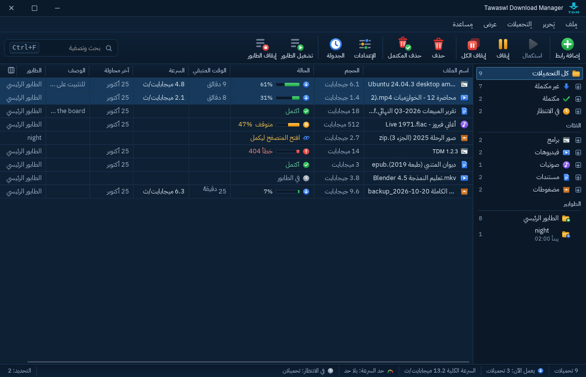
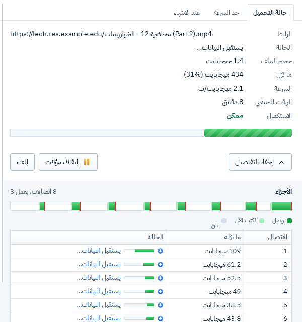
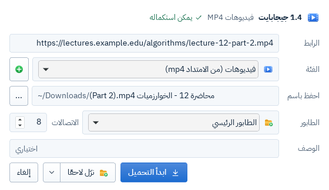

# TDM 0.1.0: نسخة تجريبية

**هذه نسخة للتجربة، لا للاستعمال اليومي بعد.** قد تجد فيها أخطاء، ونرجو أن تخبرنا بها في [Issues](https://github.com/tawaswlsy-stack/TDM/issues).

## صور

صور حقيقية من الـ CI (بيانات تجريبية فقط):

| النافذة الرئيسية (فاتح) | النافذة الرئيسية (داكن) |
|---|---|
|  |  |
| **نافذة التقدم بالأجزاء** | **معلومات ملف التحميل** |
|  |  |

## ما الموجود

- **التحميل:** حتى 32 اتصالًا للملف الواحد، وتقسيم أبطأ جزء حين يفرغ اتصال، والاستكمال بعد الانقطاع أو إغلاق البرنامج، وإعادة المحاولة بانتظار يكبر، واحترام `Retry-After`. وHTTPS بالتحقق الكامل من الشهادات دائمًا.
- **الواجهة بالعربية أولًا** (ومعها الإنجليزية)، من اليمين إلى اليسار، بالوضع الفاتح والداكن: نافذة رئيسية بشريط عنوان خاص وقوائم وأعمدة وقائمة الزر الأيمن واختصارات، ونافذة «إضافة رابط»، ونافذة «معلومات ملف التحميل»، ونافذة تقدم لكل تحميل. و«تحديث الرابط» من قائمة الزر الأيمن حين ينتهي رابط تحميل. وإغلاق النافذة يخفيها في شريط النظام (إلا إن أطفأت ذلك من الإعدادات، أو لم يكن في سطح مكتب لينكس شريط نظام، فيُغلق)، والخروج يسأل أولًا إن كانت تحميلات تعمل.
- **الطوابير:** تظهر في النافذة الرئيسية، ويُضاف إليها من «معلومات ملف التحميل» («نزّل لاحقًا»)، وتُشغَّل وتُوقف من شريط الأدوات. و**نافذة «الجدولة»** (من شريط الأدوات، أو Ctrl+J، أو ⌘J في ماك): طابور جديد وحذفه، وموعد البدء بالساعة والأيام، وموعد الإيقاف (ما لم يكتمل يُستكمل في الموعد التالي)، وعدد التحميلات في الوقت نفسه، وما يحدث بعد انتهاء الطابور (لا شيء، أو إغلاق الجهاز، أو إسباته، بعد عدّ تنازلي يمكن إلغاؤه)، وترتيب تحميلات الطابور. ونفس ذلك من سطر الأوامر (`tdm queue`).
- **حد السرعة** للبرنامج كله ولكل تحميل.
- **التصنيفات** حسب نوع الملف والموقع، ولكل تصنيف مجلده. وتصدير الطوابير واستيرادها.
- **إضافة المتصفح** لـ Chrome وEdge وFirefox: «حمّل بTDM» من قائمة الزر الأيمن، والتقاط التحميلات، وكوكيز الموقع بإذن اختياري يُطلب مرة واحدة (في الذاكرة فقط، لا على القرص).
- **الأمان:** البرامج والمثبّتات والسكربتات وملفات Office ذات الماكرو القادمة من المتصفح تنتظر موافقتك («ينتظر موافقتك») قبل تحميلها، وكل ملف يُحمَّل يحمل علامة النظام «من الإنترنت».
- **مراقبة الحافظة** (مطفأة افتراضيًا)، وأيقونة في شريط النظام، وإشعارات، والتشغيل مع بدء النظام.
- **سطر الأوامر** (`tdm`، بالإنجليزية): `get` و`resume` و`queue` و`category`، و`batch` للتحميل بالجملة بالأنماط (مثل `tdm batch 'https://example.com/img[001-100].jpg'`). ويُثبَّت بجانب البرنامج: `/usr/bin/tdm` (الـ `.deb`)، و`/Applications/TDM.app/Contents/MacOS/tdm`، و`%LOCALAPPDATA%\TDM\tdm.exe`.

## ما الذي يأتي بعد ذلك

**في 0.1.1:** فحص التحديث: يقول TDM «توجد نسخة جديدة» مع رابط صفحة الإصدار فقط، ولا ينزّل ولا يثبّت شيئًا، ويُطفأ من الإعدادات. وحتى ذلك، تابع [صفحة الإصدارات](https://github.com/tawaswlsy-stack/TDM/releases).

**في 0.2:**

- **تحميل الفيديو** بـ yt-dlp وFFmpeg ([ADR-0009](https://github.com/tawaswlsy-stack/TDM/blob/main/docs/adr/0009-video-tools.md)). وأمر الفيديو في قائمة الزر الأيمن يقول الآن «قادم قريبًا».
- **تحميل الموقع (Site Grabber)** ([ADR-0010](https://github.com/tawaswlsy-stack/TDM/blob/main/docs/adr/0010-site-grabber-and-batch.md)).
- **البروكسي**.

## الملفات

| النظام | الملف | ملاحظة |
|---|---|---|
| ماك (Apple Silicon وIntel) | `TDM_0.1.0_universal.dmg` | macOS 11 أو أحدث |
| ويندوز 10 و11 (x64) | `TDM_0.1.0_x64-setup.exe` | يُثبَّت للمستخدم الحالي، بلا صلاحيات مدير |
| لينكس (x64) | `TDM_0.1.0_amd64.deb` | Ubuntu 22.04 وDebian 12 أو أحدث. **لإضافة المتصفح، استعمل هذا الملف** |
| لينكس (x64) | `TDM_0.1.0_amd64.AppImage` | يعمل بلا تثبيت، **لكن الإضافة لا تصل إليه** (يعمل من مجلد مؤقت لا يُسجَّل عند المتصفح بأمان) |
| Chrome وEdge (116 أو أحدث) | `tdm-extension-chrome-edge-0.1.0.zip` | انظر «تركيب الإضافة» |
| Firefox (142 أو أحدث) | `tdm-extension-firefox-0.1.0.zip` | يُرفع إلى AMO ليوقَّع. انظر «تركيب الإضافة» |
| البصمات | `SHA256SUMS` | انظر «التأكد من الملفات» |

## TDM غير موقَّع من Apple ولا Microsoft

هذا قرار مقصود: TDM مشروع مجاني ومفتوح المصدر، **ولن يُوقَّع من Apple ولا Microsoft**. على ماك توقيع ad-hoc فقط. والذي يثبت أن الملف هو ملفنا: بصمات `SHA256SUMS` المنشورة هنا، والكود كله على GitHub، والمثبّتات تُبنى من الـ CI فقط. لذلك يظهر تحذير أول مرة:

**ويندوز:**
- قد ينبّهك المتصفح أولًا بأن الملف لا يُنزَّل كثيرًا: اختر **Keep** (وفي Edge: **…** ← **Keep** ← **Show more** ← **Keep anyway**).
- عند تشغيل المثبّت تظهر «Windows protected your PC» (SmartScreen): اضغط **More info** (مزيد من المعلومات)، ثم **Run anyway** (تشغيل على أي حال).
- وفي ويندوز 11 حين يكون **Smart App Control** مفعّلًا، يمنع ويندوز البرامج غير الموقَّعة بلا زر **Run anyway**، فلا يعمل TDM 0.1 هناك.

**ماك (Gatekeeper):**
1. افتح الـ `.dmg` واسحب TDM إلى مجلد Applications.
2. افتح TDM. تظهر رسالة بأن ماك لا يستطيع التحقق منه. اضغط **Done** (أو **OK**).
3. افتح **System Settings** (إعدادات النظام) ← **Privacy & Security** (الخصوصية والأمان)، وانزل إلى قسم Security، واضغط **Open Anyway** (فتح على أي حال) بجانب رسالة TDM، ثم أكّد بكلمة مرور الجهاز. (يظهر الزر نحو ساعة بعد الخطوة 2.)
4. إن سأل ماك مرة أخرى، اضغط **Open Anyway**. بعد ذلك يفتح TDM عاديًا.

**لينكس:** `sudo apt install ./TDM_0.1.0_amd64.deb`. وللـ AppImage: `chmod +x TDM_0.1.0_amd64.AppImage` ثم شغّله.

## تركيب الإضافة

ثبّت TDM وشغّله مرة واحدة أولًا: هو الذي يسجّل نفسه عند المتصفحات في كل تشغيل. وإن لم تصل الإضافة إليه، فمن الإعدادات ← «المتصفح» ← «أصلح التكامل مع المتصفح».

**Chrome وEdge (حتى تُنشر في المتاجر):**
1. فك ضغط `tdm-extension-chrome-edge-0.1.0.zip` في مجلد دائم (لا تحذفه بعد التركيب).
2. افتح `chrome://extensions` (أو `edge://extensions` في Edge)، وفعّل **Developer mode** (وضع المطوّر).
3. اضغط **Load unpacked** (تحميل غير مُحزَّم) واختر المجلد الذي فككته.
4. معرّف الإضافة يجب أن يكون `nbgfmhkjbkmldddelnepobieoehecmif`. TDM لا يقبل غيره.

**Firefox:** يحتاج Firefox إضافة موقَّعة من Mozilla. **سننشر هنا رابط النسخة الموقَّعة من AMO** حين تجهز. وللتجربة قبل ذلك: افتح `about:debugging#/runtime/this-firefox`، واضغط **Load Temporary Add-on**، واختر ملف `manifest.json` من داخل `tdm-extension-firefox-0.1.0.zip` بعد فك ضغطه. (تبقى حتى إغلاق Firefox فقط.)

**على لينكس:** المتصفحات المثبّتة بـ Flatpak، وChromium من snap، لا تشغّل برنامجًا خارج عزلها، فلا تصل الإضافة منها إلى TDM.

## التأكد من الملفات (SHA256SUMS)

نزّل `SHA256SUMS` في نفس مجلد الملفات، ثم:

- **ماك:** `shasum -a 256 -c SHA256SUMS --ignore-missing`
- **لينكس:** `sha256sum -c SHA256SUMS --ignore-missing`
- **ويندوز (PowerShell):** `(Get-FileHash .\TDM_0.1.0_x64-setup.exe).Hash -eq (Select-String -SimpleMatch 'TDM_0.1.0_x64-setup.exe' .\SHA256SUMS).Line.Split(' ')[0]`

كل سطر يجب أن ينتهي بـ `OK` (وفي ويندوز يجب أن يطبع الأمر `True`). وإذا لم يحدث، **لا تشغّل الملف** وأخبرنا.

## الإزالة

- أولًا، إن فعّلت «شغّل TDM مع بدء النظام» فأطفئه من الإعدادات.
- **ويندوز:** من «الإعدادات» ← «التطبيقات»، أو `uninstall.exe` في `%LOCALAPPDATA%\TDM`. وتبقى بيانات TDM في نفس المجلد وفي `%APPDATA%\tdm`، وتسجيله عند المتصفحات في `HKCU\Software\<المتصفح>\NativeMessagingHosts\<TDM host name from this release>`.
- **ماك:** اسحب TDM من Applications إلى سلة المهملات. وتبقى بياناته `~/Library/Application Support/tdm`، وسجلّاته `~/Library/Logs/tdm`، وتسجيله عند كل متصفح (`<TDM host name from this release>.json` في مجلد `NativeMessagingHosts` الخاص بالمتصفح، مثل `~/Library/Application Support/Google/Chrome/NativeMessagingHosts`).
- **لينكس:** `sudo apt remove tdm`. وتبقى `~/.config/tdm` و`~/.local/share/tdm` و`~/.local/state/tdm`، وتسجيله عند المتصفحات (`~/.config/<المتصفح>/NativeMessagingHosts` و`~/.mozilla/native-messaging-hosts`). وللـ AppImage: احذف الملف.
- احذف هذه إن أردت إزالة بيانات TDM وتسجيله.

## ما لم يُجرَّب بعد

- جُرِّب كل مثبّت في الـ CI على نظامه (التثبيت، ووجود `tdm-host` و`tdm` بجانب البرنامج، والإزالة). وجُرِّب مثبّت ماك على جهاز واحد: التثبيت، والفتح، وتسجيل `tdm-host` عند Chrome وChromium وEdge وFirefox، والإغلاق، والإزالة. **لم يُجرَّب يدويًا على ويندوز ولينكس.**
- الإضافة مع المتصفحات الحقيقية: بعض الاختبارات اليدوية ما زالت قائمة ([#85](https://github.com/tawaswlsy-stack/TDM/issues/85)).
- إطفاء الجهاز وإسباته بعد طابور: مختبر بمحاكاة فقط ([#34](https://github.com/tawaswlsy-stack/TDM/issues/34)).

---

# TDM 0.1.0: test build

**This is a build to try, not for daily use yet.** Please report problems in [Issues](https://github.com/tawaswlsy-stack/TDM/issues).

## Screenshots

Real screenshots from CI (test data only):

| Main window (light) | Main window (dark) |
|---|---|
|  |  |
| **The progress window with its parts** | **Download file info** |
|  |  |

## What's in it

- **Downloads:** up to 32 connections per file, splitting the slowest part when a connection is free, resume after a cut or a restart, retries with growing waits, `Retry-After` respected. HTTPS always with full certificate checks.
- **Arabic-first interface** (and English), right to left, light and dark: a main window with its own title bar, menus, columns, a right-click menu and shortcuts, the «Add a link» and «Download file info» windows, and a progress window for each download. «Refresh link» from the right-click menu when a download link expires. Closing the window hides it in the tray (unless turned off in the settings; on a Linux desktop with no tray, closing quits), and quitting asks first while downloads are running.
- **Queues:** shown in the main window, filled from «Download file info» («Download later»), started and stopped from the toolbar. The **«Schedule» window** (from the toolbar, Ctrl+J, or ⌘J on macOS): new queues and deleting them, a start time and days, a stop time (what is not finished goes on at the next start), downloads at the same time, what happens when the queue is done (nothing, shut down or sleep, after a countdown you can cancel), and the order of the queue's downloads. The same from the command line (`tdm queue`).
- **Speed limits** for the whole program and for each download.
- **Categories** by file type and site, each with its folder. Export and import of queues.
- **Browser extension** for Chrome, Edge and Firefox: «Download with TDM» in the right-click menu, download capture, the site's cookies with an optional permission asked once (kept in memory only).
- **Safety:** programs, installers, scripts and Office files with macros that come from the browser wait for your OK («Waits for your OK») before they download, and every downloaded file carries the system's "from the internet" mark.
- **Clipboard monitoring** (off by default), tray icon, notifications, start with the system.
- **Command line** (`tdm`): `get`, `resume`, `queue`, `category`, and `batch` for pattern downloads (such as `tdm batch 'https://example.com/img[001-100].jpg'`). It is installed next to the program: `/usr/bin/tdm` (.deb), `/Applications/TDM.app/Contents/MacOS/tdm`, `%LOCALAPPDATA%\TDM\tdm.exe`.

## Coming next

**In 0.1.1:** the update check: TDM says «A new version is available» with a link to the release page; it never downloads or installs anything, and it can be turned off in the settings. Until then, watch the [releases page](https://github.com/tawaswlsy-stack/TDM/releases).

**In 0.2:**

- **Video downloads** with yt-dlp and FFmpeg ([ADR-0009](https://github.com/tawaswlsy-stack/TDM/blob/main/docs/adr/0009-video-tools.md)). The extension's «Download video with TDM» menu item answers «coming soon» for now.
- **Site Grabber** ([ADR-0010](https://github.com/tawaswlsy-stack/TDM/blob/main/docs/adr/0010-site-grabber-and-batch.md)).
- **Proxy.**

## Files

| System | File | Note |
|---|---|---|
| macOS (Apple Silicon and Intel) | `TDM_0.1.0_universal.dmg` | macOS 11 or later |
| Windows 10 and 11 (x64) | `TDM_0.1.0_x64-setup.exe` | installs for the current user, no admin rights |
| Linux (x64) | `TDM_0.1.0_amd64.deb` | Ubuntu 22.04, Debian 12 or later. **Use this one for the browser extension** |
| Linux (x64) | `TDM_0.1.0_amd64.AppImage` | runs without installing, **but the extension cannot reach it** (it runs from a temporary folder that cannot safely be registered with a browser) |
| Chrome and Edge (116 or later) | `tdm-extension-chrome-edge-0.1.0.zip` | see «Installing the extension» |
| Firefox (142 or later) | `tdm-extension-firefox-0.1.0.zip` | uploaded to AMO for signing; see below |
| Checksums | `SHA256SUMS` | see «Checking the files» |

## Not signed by Apple or Microsoft

On purpose: TDM is free and open source and **will not be signed by Apple or Microsoft**. macOS gets an ad-hoc signature only. What proves a file is ours: the `SHA256SUMS` published here, the code on GitHub, and installers built by CI only. So you will see a warning the first time:

**Windows:**
- Your browser may first warn that the file is not commonly downloaded: choose **Keep** (in Edge: **…** → **Keep** → **Show more** → **Keep anyway**).
- Running the installer shows «Windows protected your PC» (SmartScreen): click **More info**, then **Run anyway**.
- On Windows 11 with **Smart App Control** turned on, Windows blocks unsigned programs and offers no **Run anyway**, so TDM 0.1 cannot run there.

**macOS (Gatekeeper):**
1. Open the `.dmg` and drag TDM to Applications.
2. Open TDM. macOS says it cannot verify it. Click **Done** (or **OK**).
3. Open **System Settings** → **Privacy & Security**, scroll to Security, click **Open Anyway** next to the message about TDM, and confirm with your password. (The button shows for about an hour after step 2.)
4. If macOS asks once more, click **Open Anyway**. After that TDM opens normally.

**Linux:** `sudo apt install ./TDM_0.1.0_amd64.deb`. For the AppImage: `chmod +x TDM_0.1.0_amd64.AppImage`, then run it.

## Installing the extension

Install TDM and start it once first: it registers itself with the browsers at each start. If the extension cannot reach it, use Settings → «Browser» → «Fix the browser integration».

**Chrome and Edge (until it is in the stores):**
1. Unzip `tdm-extension-chrome-edge-0.1.0.zip` into a folder you keep.
2. Open `chrome://extensions` (or `edge://extensions`) and turn on **Developer mode**.
3. Click **Load unpacked** and choose that folder.
4. The extension id must be `nbgfmhkjbkmldddelnepobieoehecmif`; TDM accepts no other.

**Firefox:** Firefox needs an extension signed by Mozilla. **We will link the AMO-signed version here** when it is ready. To try it before then: open `about:debugging#/runtime/this-firefox`, click **Load Temporary Add-on**, and choose `manifest.json` from the unzipped `tdm-extension-firefox-0.1.0.zip` (it lasts until Firefox closes).

**On Linux:** browsers installed as Flatpak, and Chromium from snap, cannot start programs outside their sandbox, so the extension cannot reach TDM from them.

## Checking the files (SHA256SUMS)

Put `SHA256SUMS` next to the files, then:

- **macOS:** `shasum -a 256 -c SHA256SUMS --ignore-missing`
- **Linux:** `sha256sum -c SHA256SUMS --ignore-missing`
- **Windows (PowerShell):** `(Get-FileHash .\TDM_0.1.0_x64-setup.exe).Hash -eq (Select-String -SimpleMatch 'TDM_0.1.0_x64-setup.exe' .\SHA256SUMS).Line.Split(' ')[0]`

Every line must end with `OK` (on Windows, the command must print `True`). If not, **do not run the file**, and tell us.

## Uninstalling

- First, if you turned on «Start TDM with the computer», turn it off in the settings.
- **Windows:** Settings → Apps, or `uninstall.exe` in `%LOCALAPPDATA%\TDM`. TDM's data stays in that same folder and in `%APPDATA%\tdm`, and its browser registrations under `HKCU\Software\<browser>\NativeMessagingHosts\<TDM host name from this release>`.
- **macOS:** drag TDM from Applications to the Trash. Its data `~/Library/Application Support/tdm`, its logs `~/Library/Logs/tdm`, and its registration with each browser (`<TDM host name from this release>.json` in the browser's `NativeMessagingHosts` folder, such as `~/Library/Application Support/Google/Chrome/NativeMessagingHosts`) stay.
- **Linux:** `sudo apt remove tdm`; `~/.config/tdm`, `~/.local/share/tdm`, `~/.local/state/tdm` and the browser registrations (`~/.config/<browser>/NativeMessagingHosts`, `~/.mozilla/native-messaging-hosts`) stay. For the AppImage, delete the file.
- Delete these to remove TDM's data and registrations.

## Not tried yet

- Each installer was tried by CI on its own system (install, `tdm-host` and `tdm` next to the program, uninstall). The macOS one was tried on one Mac: install, open, `tdm-host` registered with Chrome, Chromium, Edge and Firefox, quit, remove. **Not tried by hand on Windows or Linux.**
- The extension with real browsers: some manual tests are still open (#85).
- Shut down and sleep after a queue: tested with a simulation only (#34).
